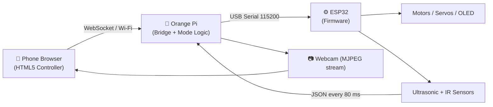
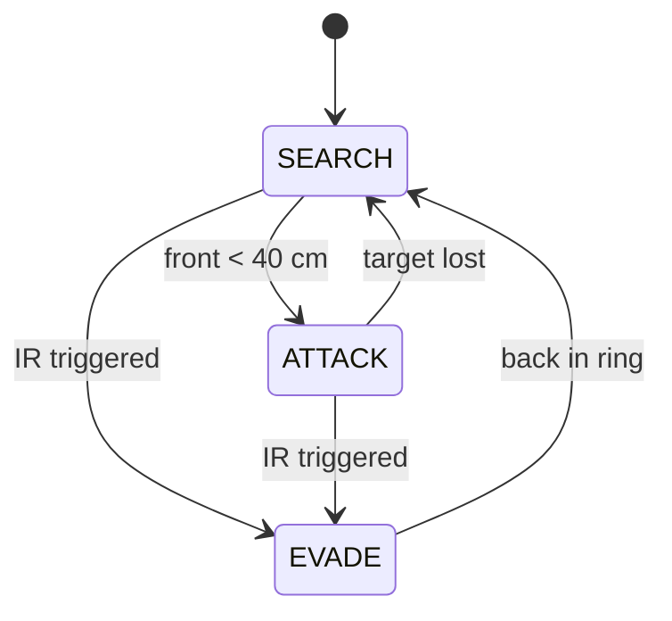
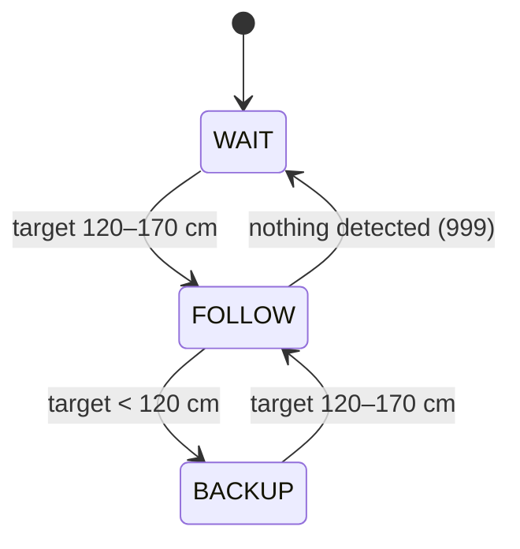
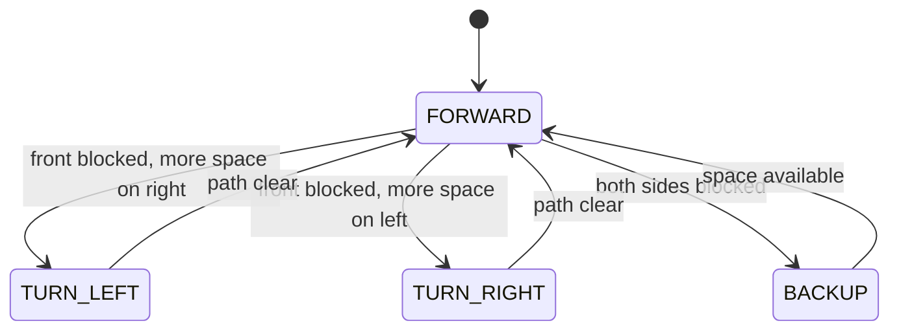

# 🤖 HX-1 Rover — ESP32 Autonomous Robot System

**with Orange Pi Bridge & Web Controller**


| | |
|---|---|
| **Project Title** | HX-1 Rover |
| **Course** | Computer Engineering |
| **Team** | ADA |
| **Date** | May 2026 |
| **Members** | Arcelo, Joffrey Troy P. · Digamon, Jazen Gabriel M. · Asas, Kenneth |

---

## 📑 Table of Contents

1. [Project Overview](#1-project-overview)
2. [Hardware Architecture](#2-hardware-architecture)
3. [Electrical Schematics & Wiring](#3-electrical-schematics--wiring)
4. [Pin Allocation Table](#4-pin-allocation-table--esp32)
5. [Mechanical Assembly](#5-mechanical-assembly)
6. [Component Placement & Assembly Steps](#6-component-placement--assembly-steps)
7. [Software Architecture](#7-software-architecture)
8. [Core Code Implementation](#8-core-code-implementation)
9. [Testing & Calibration](#9-testing--calibration)
10. [Operation & Control](#10-operation--control)
11. [Troubleshooting](#11-troubleshooting)
12. [Future Enhancements](#12-future-enhancements)
13. [Photos / Videos](#13-photos--videos)
14. [The Team](#14-the-team)
15. [Appendices](#15-appendices)
16. [Acknowledgement](#acknowledgement)

---

## 1. Project Overview

### Purpose & Scope

This project presents the design and implementation of an **autonomous multi-mode robot system** built on the ESP32 microcontroller platform. The robot operates in **three autonomous modes** plus a **manual control mode** via a smartphone web interface.

**Key objectives**

- Design a reliable hardware platform using ESP32, L298N motor driver, PCA9685 servo driver, and HC-SR04 ultrasonic sensors.
- Implement autonomous behaviors: **Sumobot**, **Human Following**, **Obstacle Avoidance**, and **Manual Mode**.
- Develop a web-based controller accessible from any smartphone browser on the same network.
- Use an Orange Pi single-board computer as a network bridge between the phone controller and the ESP32.

### Common Platform

All modes share the same hardware and software platform:

| Item | Description |
|---|---|
| Microcontroller | ESP32 (dual-core 240 MHz, Wi-Fi + Bluetooth) |
| Motor driver | L298N dual H-bridge |
| Servo controller | PCA9685 16-channel PWM driver |
| Display | SH1106 1.3" OLED (128×64) |
| Bridge | Orange Pi running a WebSocket server (`bridge`) |
| Controller | HTML5 web app served from the Orange Pi |
| Communication | WebSocket over Wi-Fi hotspot |

---

## 2. Hardware Architecture

### Bill of Materials (BOM)

| Component | Specification | Qty | Purpose | Price (₱) |
|---|---|:-:|---|--:|
| ESP32 Dev Board | Dual-core 240 MHz | 1 | Main controller | 319 |
| L298N Motor Driver | 2A per channel | 1 | Motor control | 250 |
| DC Motors (geared) | 12V / 300 RPM | 4 | Drive wheels | 710 |
| PCA9685 Driver | 16-ch PWM, I2C | 1 | Servo control | 132 |
| SH1106 OLED | 1.3" 128×64, I2C | 1 | Status display | 139 |
| Li-Po Battery | 7.4V 2200mAh | 6 | Power source | 1,140 |
| HC-SR04 Ultrasonic | 2 cm – 400 cm range | 3 | Distance sensing | 276 |
| IR Sensor Module | Active LOW output | 2 | Edge/object detect | 60 |
| Orange Pi One | 1 GB Linux SBC | 1 | Network bridge | 1,500 |
| USB Cable | Type-C | 1 | Serial to Orange Pi | 150 |
| Sintra Board (hard) | 4WD platform | 1 | Physical frame | 864 |
| Yellow LED | Signal light | 4 | Signal light | 20 |
| Webcam | 1920×1080 | 2 | Live feed view | 1,840 |
| Servo MG90 | Metal gear | 4 | Robotic arm | 780 |
| Servo MG995 | Metal gear | 2 | Robotic arm | 490 |
| TP-Link Wi-Fi Dongle | Single band, Linux support | 1 | Wireless control | 385 |
| USB Hub | USB 3.0, 4 ports | 1 | USB connections | 299 |
| Jumper Wires | 10 cm, 3/pack | — | Connectors | 96 |
| JST Connectors | 10 cm, 5-pin | 3 | Connectors | 36 |
| JST Connectors | 10 cm, 2-pin | 4 | Connectors | 32 |
| Universal PCB | 15×15 cm | 1 | Final installation | 15 |
| Rubber Wheels | 43 mm | 4 | Wheels | 154 |
| Buck Converter | 12V to 5V | 2 | DC step-down | 56 |
| | | | **Total** | **₱9,743** |

---

## 3. Electrical Schematics & Wiring


> 📌 *Add the wiring diagram image from Section 3 of the PDF to an `images/` folder.*

### Common Power Distribution

- **Li-Po Battery (12V)** → L298N motor driver (VIN) → motors
- **Buck Converter 5V** → sensors
- **ESP32** powered via USB from the Orange Pi (5V)
- **PCA9685** VCC → 5V; V+ → servo power rail (*separate supply recommended for servos*)
- **Orange Pi** connects to the 5V buck converter
- **OLED** connects to the ESP32
- **Webcam and Wi-Fi dongle** connect to the USB hub

---

## 4. Pin Allocation Table — ESP32

| Pin | GPIO | Function | Notes |
|---|:-:|---|---|
| ENA | 25 | Motor L — PWM speed | LEDC channel 0 |
| IN1 | 26 | Motor L — direction A | L298N |
| IN2 | 27 | Motor L — direction B | L298N |
| ENB | 13 | Motor R — PWM speed | LEDC channel 1 |
| IN3 | 14 | Motor R — direction A | L298N |
| IN4 | 12 | Motor R — direction B | L298N |
| SIG_L | 4 | Left signal light | Active HIGH |
| SIG_R | 5 | Right signal light | Active HIGH |
| SDA | 21 | I2C data | OLED + PCA9685 |
| SCL | 22 | I2C clock | OLED + PCA9685 |
| TRIG_F | 32 | Front ultrasonic trigger | OUTPUT |
| ECHO_F | 33 | Front ultrasonic echo | INPUT (voltage divider) |
| TRIG_L | 16 | Left ultrasonic trigger | OUTPUT |
| ECHO_L | 17 | Left ultrasonic echo | INPUT (voltage divider) |
| TRIG_R | 15 | Right ultrasonic trigger | OUTPUT |
| ECHO_R | 23 | Right ultrasonic echo | INPUT (voltage divider) |
| IR | 18 | IR sensor | INPUT, active LOW |
| TX | 1 | USB serial to Orange Pi | 115200 baud |
| RX | 3 | USB serial from Orange Pi | 115200 baud |

### ⚠️ Voltage Divider — ECHO Pin Protection

The HC-SR04 ECHO pin outputs **5V**, but ESP32 GPIO pins tolerate a maximum of **3.3V**. A voltage divider is **required** on all 3 ECHO pins:

```
ECHO (5V) ─1kΩ─┬────→ ESP32 GPIO
               │
              2kΩ
               │
              GND
```

```
Vout = 5V × 2kΩ / (1kΩ + 2kΩ) = 3.33V  ✓ safe for ESP32
```

---

## 5. Mechanical Assembly

### Chassis Layout

| Lower Chassis | Upper Chassis |
|---|---|
|  |  |

### Turret & Robotic Arm

| Turret | Robotic Arm |
|---|---|
|  |  |

The arm uses **MG995** servos at the base and **MG90** servos for the upper joints and gripper, all driven through the PCA9685.

---

## 6. Component Placement & Assembly Steps


### Assembly Steps

1. Attach motors to the chassis motor mounts using M3 screws.
2. Mount wheels onto motor shafts and secure with shaft collars.
3. Mount the L298N motor driver on the upper deck.
4. Mount the ESP32 development board on the chassis.
5. Mount HC-SR04 sensors at the front, left, and right positions.
6. Mount IR sensors on the underside of the chassis facing downward.
7. Wire all components per the [pin allocation table](#4-pin-allocation-table--esp32).
8. Install voltage dividers on the ECHO pins **before** connecting to the ESP32.
9. Install the webcam on the turret facing forward.
10. Plug the Wi-Fi dongle into the USB hub.

---

## 7. Software Architecture

### Three-Tier Architecture

| Tier | Component | Responsibility |
|:-:|---|---|
| 1 | Phone Browser (HTML) | User interface, joystick, mode selection |
| 2 | Orange Pi (`bridge`) | WebSocket server, autonomous mode logic, serial bridge |
| 3 | ESP32 (`.ino` firmware) | Motor control, sensor reading, servo control, OLED |



### Libraries

- `Adafruit_SH110X` — OLED display driver
- `Adafruit_PWMServoDriver` — PCA9685 servo controller
- `Wire.h` — I2C communication
- **Java WebSockets** — WebSocket server on Orange Pi
- **jSerialComm** — serial communication to the ESP32

### Finite State Machines

#### 🥋 Sumobot Mode



- **SEARCH** — robot spins slowly looking for the opponent
- **ATTACK** — front ultrasonic detects opponent < 40 cm → full-speed charge
- **EVADE** — IR sensor detects ring edge → back up and turn back into the ring

#### 🚶 Human Following Mode



- **WAIT** — front ultrasonic reads 999 (nothing detected) → stop
- **FOLLOW** — target between 120 cm and 170 cm → adjust speed and steer
- **BACKUP** — target closer than 120 cm → reverse
- Side ultrasonics steer the robot left/right toward the person.

#### 🚧 Obstacle Avoidance Mode



- **FORWARD** — all sensors clear → drive straight
- **TURN_LEFT** — front blocked + more space on the right → turn left
- **TURN_RIGHT** — front blocked + more space on the left → turn right
- **BACKUP** — both sides blocked → reverse

#### 🎮 Manual Mode

1. The HTML5 controller sends a command to the Orange Pi.
2. The Orange Pi forwards the command to the ESP32 via Java serial.

---

## 8. Core Code Implementation

### `setup()` Structure

1. Initialize Serial at 115200 baud
2. Configure motor pins (IN1–IN4) and LEDC PWM channels (ENA, ENB)
3. Configure light pins (`SIG_LEFT`, `SIG_RIGHT`)
4. Configure ultrasonic pins (TRIG/ECHO for F, L, R)
5. Configure IR sensor pins
6. Initialize I2C (GPIO21 = SDA, GPIO22 = SCL)
7. Initialize PCA9685 — oscillator 27 MHz, PWM frequency 50 Hz
8. Center all servos at 90°
9. Initialize OLED and display the boot splash

### `loop()` Structure

| Function | Purpose |
|---|---|
| `readUSBSerial()` | Parse incoming commands from the Orange Pi |
| `safetyCheck()` | Stop motors if no `DRIVE` or `PING` received recently |
| `updateSensors()` | Round-robin HC-SR04 reads (one per 80 ms tick) |
| `sendSensorData()` | Send JSON to the Orange Pi every 80 ms |
| `updateServos()` | Slew servos toward targets |
| `updateLights()` | `millis()`-based blink timer |
| `updateOLED()` | Refresh display every 200 ms |

### Motor Driver Abstraction

```cpp
void setMotors(int left, int right) {
  // constrain to -255 to 255
  // set IN1/IN2 for direction
  // ledcWrite() for speed
}
```

### Key Functions (Orange Pi Bridge)

| Mode | Function | Behavior |
|---|---|---|
| Sumobot | `do_sumo(f, l, r, il, ir)` | State machine SEARCH → ATTACK → EVADE; non-blocking, runs on an 80 ms tick |
| Obstacle Avoidance | `do_obstacle(f, l, r, il, ir)` | Picks the turn direction based on which side has more space |
| Manual | `do_manual(data)` | Receives commands from the controller; side sensors detect open space, front sensor detects walls |
| Human Following | `do_follow(f, l, r, il, ir)` | Front ultrasonic maintains ~150 cm target distance; side ultrasonics steer toward the person |

### Sensor Calibration Procedure

1. Point each HC-SR04 at a wall exactly **30 cm** away.
2. Open the Serial Monitor and verify the reading is **30 ± 3 cm**.
3. Adjust `ECHO_TIMEOUT` if sensors return `999` at close range.
4. For IR sensors, adjust the onboard potentiometer until the LED turns on at **15–20 cm**.

---

## 9. Testing & Calibration

### Test Sketches

| Sketch | Purpose |
|---|---|
| `ESP32_UltrasonicTest.ino` | Tests each HC-SR04 one at a time |
| `ESP32_IR_Test.ino` | Verifies IR detection output |
| `ESP32_MotorTest.ino` | Tests F/B/L/R via Serial Monitor commands |

All test sketches output to the Serial Monitor at **115200 baud**.

### Motor Tuning

- Start at 50% speed (`motorSpeed = 128`) to verify direction.
- If a motor spins the wrong way, swap IN1/IN2 or IN3/IN4 wires.
- Adjust `speedLimit` in the HTML controller for fine control.

### Per-Mode Validation

**Sumobot**
- Place the robot on a sumo ring (black surface with white border).
- Verify the IR triggers when crossing the white line → robot backs up.
- Place an object in front — the robot should spin to find it, then charge.

**Human Following**
- Stand 150 cm in front — robot should hold position.
- Walk forward (closer) — robot backs up.
- Walk backward (farther) — robot follows.

**Obstacle Avoidance**
- Place walls around the robot — it should navigate without collisions.
- Verify all three ultrasonic sensors trigger avoidance.

---

## 10. Operation & Control

### Power-Up Sequence

1. Connect the Orange Pi to power — wait for boot (~30 seconds).
2. Connect the ESP32 to the Orange Pi via USB cable.
3. The Orange Pi auto-detects the ESP32 port and starts the bridge.
4. The OLED shows **"ROBOT READY — Waiting for Orange Pi"**.
5. Connect your phone to the **`OrangePiRobotCamera`** Wi-Fi hotspot.
6. Open a browser and go to **`http://192.168.100.1:9090`**.
7. The status dot turns **green** — the controller is live.

### Remote Control — Web App

| Tab | Features |
|---|---|
| **DRIVE** | Joystick for manual control, speed slider, mode buttons, lights |
| **ARM** | 6 servo sliders, arm speed control, center button |
| **CAM** | Full-screen live camera stream from the Orange Pi |

### Mode Selection

| Mode | Behavior |
|---|---|
| 🎮 MANUAL | Joystick and PS4 gamepad control |
| ⚔️ SUMO | Autonomous sumo ring competition mode |
| 🚶 FOLLOW | Follows a person at 150 cm using the front ultrasonic |
| 🚧 OBSTACLE | Avoids obstacles autonomously |

---

## 11. Troubleshooting

| Problem | Likely Cause | Fix |
|---|---|---|
| Sensors always read 999 | No echo received | Check 5V VCC, check voltage divider on ECHO, point at a surface |
| Motors don't move | Wrong pins / no PWM | Check ENA/ENB wired to LEDC pins 25/13, verify IN1–IN4 |
| Robot drifts left/right | Motor speed mismatch | One motor may be faster — adjust motor trim in code |
| WebSocket keeps disconnecting | Port in use | Run `fuser -k 8765/tcp` on the Orange Pi |
| OLED blank | I2C address wrong | Try `0x3C` or `0x3D`; check SDA/SCL on GPIO21/22 |
| Camera not loading | `mjpg-streamer` not running | Check `ps aux \| grep mjpg`, restart the service |
| ESP32 not uploading | Not in boot mode | Hold the BOOT button while clicking Upload |
| IR always DETECTED | Active-HIGH module | Change `== LOW` to `== HIGH` in the ESP32 code |
| Servo jitters | Too many rapid commands | Slider throttle of 60 ms is built in — do not reduce |
| `OSError 98` on bridge | Port already in use | Run `fuser -k 8765/tcp 9090/tcp \|\| true` |

### Debugging via Serial Output

Open the Arduino IDE Serial Monitor at **115200 baud** to see:

- `[ESP32] Ready` — startup confirmed
- JSON sensor data every 80 ms:

```json
{"F":42,"L":88,"R":15,"IL":0,"IR":0,"SL":0,"SR":0}
```

On the Orange Pi, view WebSocket events and mode changes with:

```bash
journalctl -fu robot-bridge
```

---

## 12. Future Enhancements

- [ ] Wireless score display (LED matrix or secondary OLED) for Sumobot matches
- [ ] Swap chassis modules without rewiring using a modular JST connector system
- [ ] Multi-robot communication via **ESP-NOW** for team-based modes
- [ ] Wheel encoders for precise odometry and position tracking
- [ ] Upgrade the camera pipeline to **WebRTC** for lower-latency streaming
- [ ] Speaker / buzzer for audio feedback on mode changes
- [ ] **PID motor control** for smoother straight-line driving
- [ ] Data logging — save sensor readings to the Orange Pi SD card for analysis

---

## 13. Photos / Videos

### Robot Images


### Team Photo


### Video Documentation

| Video | Description | Link |
|---|---|---|
| Demo Video 1 | Manual control demonstration | [Watch](#) |
| Demo Video 2 | Sumobot mode in action | [Watch](#) |
| Demo Video 3 | Obstacle avoidance test | [Watch](#) |
| Demo Video 4 | Human following mode | [Watch](#) |

---

## 14. The Team

| Name | Role | Portfolio |
|---|---|---|
| Arcelo, Joffrey Troy P. | Hardware | [Link](#) |
| Digamon, Jazen Gabriel M. | Software | [Link](#) |
| Asas, Kenneth | Hardware & Software | [Link](#) |

---

## 15. Appendices

### Appendix A: Complete File List

| File | Description |
|---|---|
| `ESP32_Robot_Final.ino` | Main ESP32 firmware |
| `bridge` | Orange Pi WebSocket bridge with autonomous modes |
| `controller.html` | Web controller interface |
| `ESP32_MotorTest.ino` | Motor test sketch |
| `ESP32_UltrasonicTest.ino` | Ultrasonic sensor test |
| `ESP32_IR_Test.ino` | IR sensor test |

### Appendix B: Calibration Logs

| Sensor | Expected (cm) | Measured (cm) | Result |
|---|:-:|:-:|:-:|
| Front HC-SR04 | 30 | 30 | ✅ Pass |
| Left HC-SR04 | 30 | 30 | ✅ Pass |
| Right HC-SR04 | 30 | 30 | ✅ Pass |
| IR Left | Detects at 15 | 13 | ✅ Pass |
| IR Right | Detects at 15 | 14 | ✅ Pass |

### Appendix C: Activity Journal

| Date | Activity | Members Present |
|---|---|---|
| 02/25/2026 | Planning | Arcelo, Asas |
| 02/27/2026 | Building the chassis | Arcelo, Asas |
| 03/03/2026 | Buying components at the local shop | Arcelo, Digamon, Asas |
| 03/04/2026 | Drilling holes and assembling components on the chassis | Arcelo, Digamon, Asas |
| 04/14/2026 | Testing components | Asas |
| 04/14/2026 | Programming the system, testing & troubleshooting | Arcelo, Digamon, Asas |
| 05/20/2026 | Finalization | Arcelo, Digamon, Asas |
| 05/26/2026 | Final check with ma'am | Arcelo, Digamon, Asas |

---

## Acknowledgement

The team would like to express our sincere gratitude to our instructor for providing guidance, resources, and continuous support throughout the development of this project. We also thank our classmates for their feedback during testing, and our families for their patience and encouragement during long development sessions. This project would not have been possible without the open-source communities behind Orange Pi, Adafruit, and the ESP32 Arduino framework.
